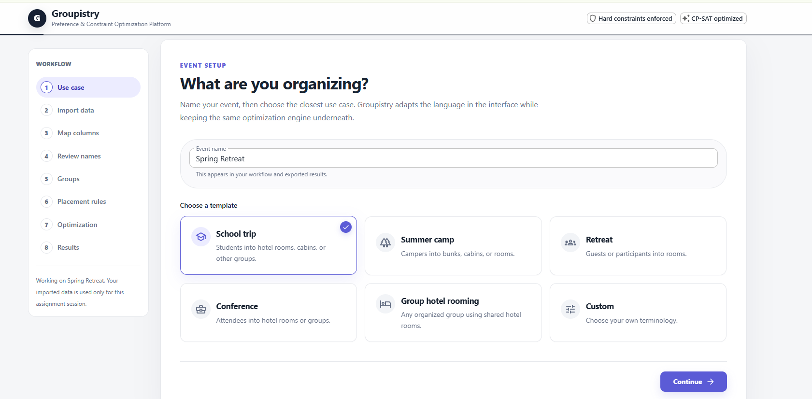
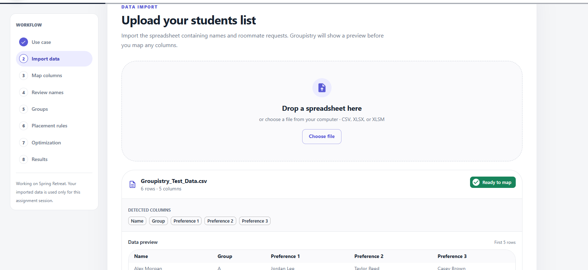
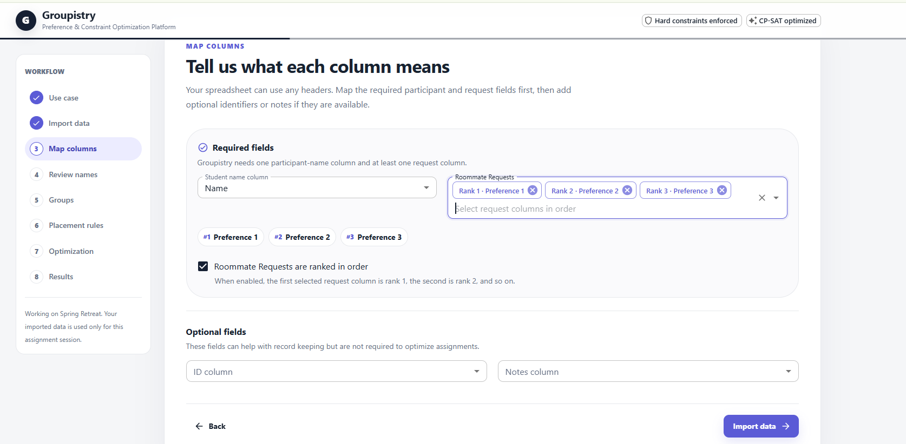
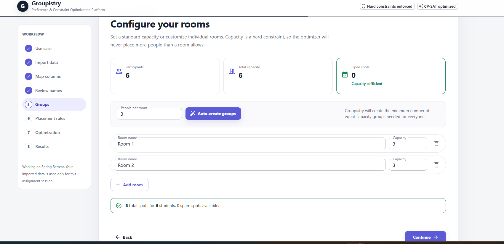
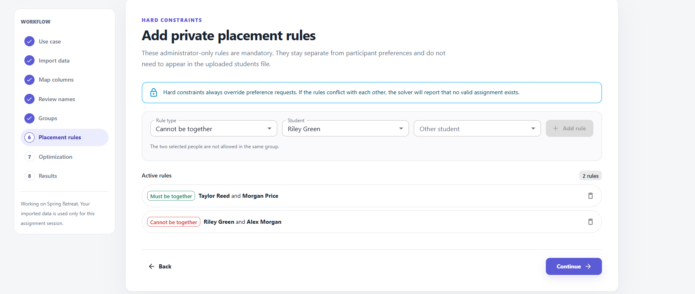
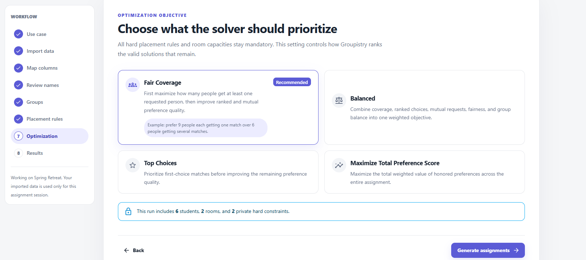
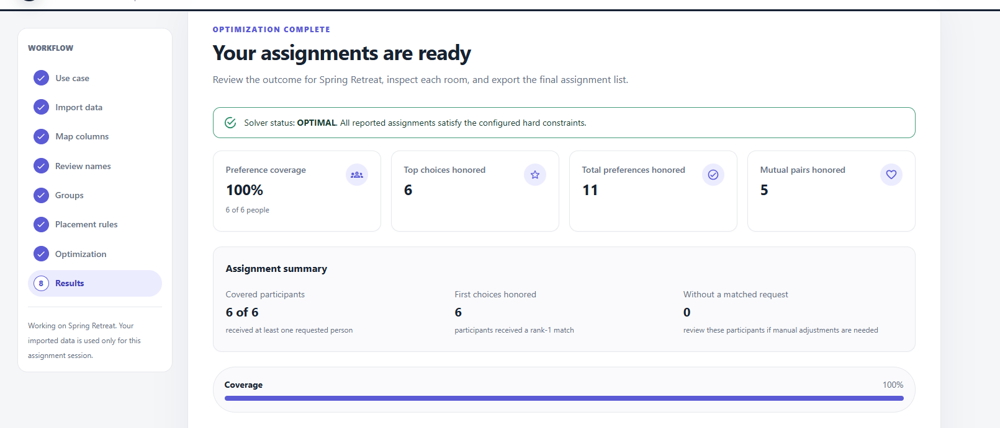
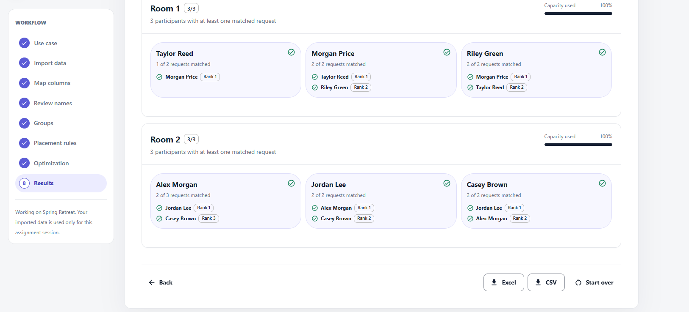

# Groupistry

**Preference & Constraint Optimization Platform**

Groupistry is a full-stack application for placing people into fixed-capacity groups while balancing ranked preferences, mutual requests, fairness, and private administrator rules. The backend models the problem with Google OR-Tools CP-SAT; the React interface guides an administrator from spreadsheet import through final export.

## What the app does

1. Choose a use case and event name.
2. Upload CSV or Excel participant data.
3. Map arbitrary spreadsheet columns to names and preferences.
4. Review unresolved or misspelled requested names.
5. Configure equal or custom group capacities.
6. Add private hard constraints such as must-be-together, cannot-be-together, or lock-to-group.
7. Choose an optimization strategy.
8. Run CP-SAT and review assignment analytics.
9. Export the result to CSV or Excel.

The recommended **Fair Coverage** mode uses lexicographic optimization: it first maximizes the number of participants who receive at least one requested person, locks that best coverage level, and then improves preference quality without sacrificing coverage.

## Product walkthrough

### 1. Event setup

Choose a use case and event name. Groupistry adapts its terminology while keeping the same optimization engine underneath.



### 2. Import participant data

Upload CSV or Excel files, review detected columns, and preview the imported data before mapping.



### 3. Map spreadsheet columns

Map arbitrary spreadsheet headers to participant names and ranked request columns.



### 4. Configure group capacity

Create equal-capacity groups automatically or customize individual groups. Capacity is enforced as a hard constraint.



### 5. Add private placement rules

Administrators can add mandatory must-be-together, cannot-be-together, and locked-group rules separately from participant requests.



### 6. Choose an optimization objective

Select Fair Coverage, Balanced, Top Choices, or Maximize Total Preference Score depending on the desired assignment strategy.



### 7. Review optimization analytics

The results dashboard reports solver status, preference coverage, top choices honored, total preferences honored, and mutual pairs honored.



### 8. Inspect and export assignments

Review each group's capacity usage and each participant's matched requests and ranks, then export the final assignment to CSV or Excel.



## Stack

- **Frontend:** React 18, TypeScript, Vite, Material UI
- **API:** FastAPI + Pydantic
- **Optimization:** Google OR-Tools CP-SAT
- **Data:** pandas + openpyxl
- **HTTP:** Axios / httpx
- **Tests:** Python unittest + API smoke test

## Project structure

```text
Groupistry/
├── api/                     # FastAPI routes, schemas, converters, session store
├── frontend/                # React + TypeScript admin interface
│   └── src/
│       ├── components/
│       ├── lib/
│       ├── steps/
│       └── types/
├── scripts/
│   └── smoke_test.py        # End-to-end test against a running API
├── tests/                   # Backend unit/API tests
├── data/
│   ├── sample_requests.csv
│   └── sample_requests.xlsx
├── docs/
│   └── screenshots/         # README product screenshots
├── optimizer.py             # CP-SAT model and objectives
├── scoring.py               # Preference weights
├── matching.py              # Name resolution
├── import_service.py        # Import orchestration
├── constraint_service.py    # Hard-constraint validation
├── export_service.py        # CSV/Excel export
├── requirements.txt
└── TESTING.md
```

# Quick start

## Prerequisites

Install:

- Python 3.11 or newer
- Node.js 20 or newer
- npm

## Fastest setup on Windows

From the project root:

```bat
setup_windows.bat
```

Then open two terminals and run:

```bat
run_backend.bat
```

and:

```bat
run_frontend.bat
```

Then open `http://localhost:5173`.

## 1. Set up the Python backend

Open a terminal in the project root.

### Windows PowerShell / Command Prompt

```bat
python -m venv .venv
.venv\Scripts\activate
python -m pip install --upgrade pip
pip install -r requirements.txt
```

### macOS / Linux

```bash
python3 -m venv .venv
source .venv/bin/activate
python -m pip install --upgrade pip
pip install -r requirements.txt
```

## 2. Start the backend

From the project root, with the virtual environment activated:

```bash
uvicorn api.main:app --reload
```

The API runs at:

```text
http://127.0.0.1:8000
```

Interactive FastAPI docs:

```text
http://127.0.0.1:8000/docs
```

Leave this terminal running.

## 3. Install and start the frontend

Open a second terminal:

```bash
cd frontend
npm install
npm run dev
```

Open:

```text
http://localhost:5173
```

The frontend defaults to `http://127.0.0.1:8000/api`. To point it elsewhere, copy `frontend/.env.example` to `frontend/.env` and change `VITE_API_URL`.

# Recommended first manual test

Use the included file:

```text
data/sample_requests.csv
```

Suggested workflow:

1. Event name: `Groupistry Demo`
2. Template: **School trip** or **Custom**
3. Upload `data/sample_requests.csv`
4. Map:
   - Name → `Name`
   - Preferences → `Preference 1`, `Preference 2`, `Preference 3`
5. Keep requests ranked.
6. Confirm all names resolve.
7. Set group capacity to **3**. The app should create two groups for six participants.
8. Continue with no private rules and choose **Fair Coverage**.
9. Generate assignments and inspect the coverage metrics.

Then test hard constraints:

- Add **Cannot be together** for `Alex Morgan` and `Jordan Lee`; rerun and verify they are in different groups even though they requested each other.
- Replace it with **Must be together** for the same two people; rerun and verify they are in the same group.

This demonstrates the central distinction: hard constraints are mandatory, while preference requests are optimized when possible.

# Automated tests

After installing Python dependencies:

```bash
python -m unittest discover -s tests
```

The tests cover:

- every participant assigned
- room/group capacity never exceeded
- must-be-with
- cannot-be-with
- locked-room
- API health and CSV import

## End-to-end API smoke test

With the backend already running in another terminal:

```bash
python scripts/smoke_test.py
```

The smoke test uploads the included CSV, imports preferences, creates capacity-3 groups, runs the optimizer, and verifies both cannot-be-with and must-be-with rules.

## Frontend build check

From `frontend/`:

```bash
npm run build
```

A successful production build is a good final check that the TypeScript frontend compiles cleanly.

# Optimization model in plain English

For every participant/group pair, CP-SAT creates a Boolean decision variable:

```text
1 = participant is assigned to that group
0 = participant is not assigned to that group
```

Hard constraints include:

- each participant is assigned exactly once
- group capacity cannot be exceeded
- must-be-together rules
- cannot-be-together rules
- locked-group rules

Soft preferences include:

- ranked requests
- mutual requests
- coverage: whether each participant gets at least one requested person

In Fair Coverage mode, Groupistry first maximizes coverage, then locks the best possible coverage and optimizes preference quality.

# Current development scope

Groupistry currently runs locally with temporary session storage. Future deployment would add persistent storage, authentication, and production data controls.
